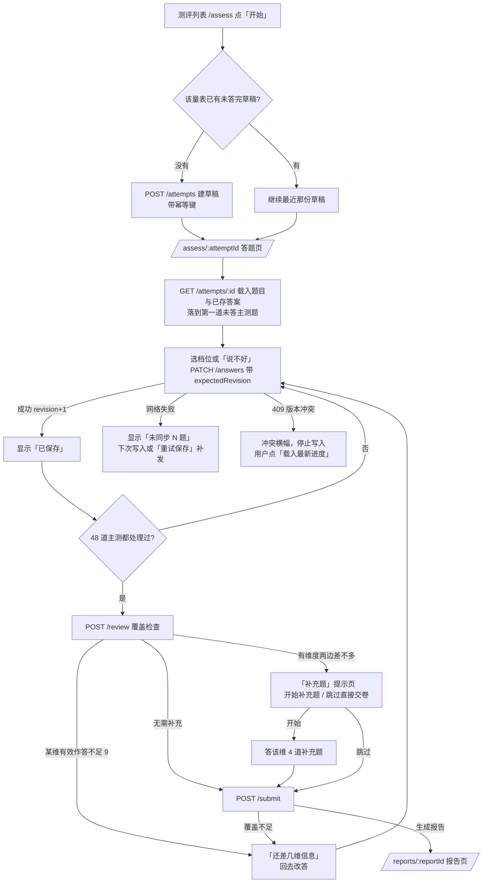
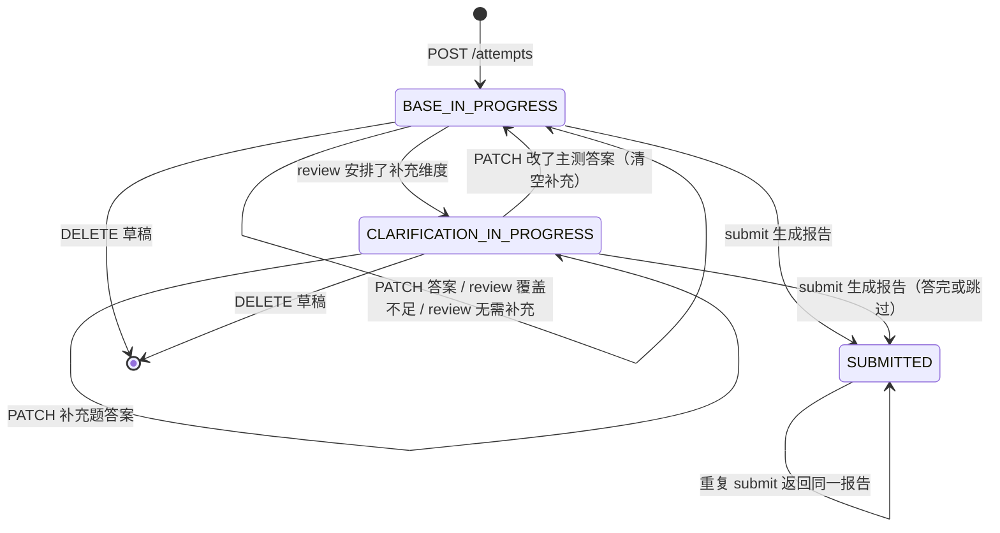
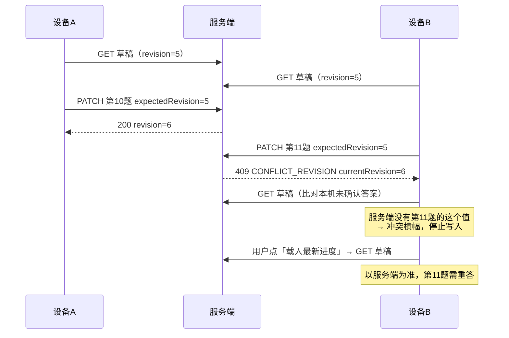

# 十六型测评（jung48）作答 → 草稿 → 跨设备冲突 → 提交出报告 业务地图

> 状态：主流程**已证实**（静态代码与契约证据，未运行浏览器/后端/数据库）；第 7 节列出 4 项「期望口径待确认」，这些场景只写当前实现，不作为验收标准。
> 范围：登录用户在新站做十六型测评（`/assess` → `/assess/:attemptId` → `/reports/:reportId`）。覆盖：开始/续答、逐题保存、覆盖检查与补充题、跨设备冲突、提交与重复提交、报告读取。
> 排除：注册登录本身、AI 分析、自我理解、复测比较、报告删除与账号注销、大五测评、旧版 IPIP/OEJTS 流程、从旧报告派生新测评（只核到接口层，见 7.4）。
> 当前内容版本：新建草稿绑定 `typeme-jung48-zh-v4`（计分 `typeme-jung48-score-v4`），见 `backend/.../jung/content/JungPackageLoader.java:81`。旧草稿按自己锁定的版本继续。

## 1. 业务概述与可观察结果

| 角色 | 入口 | 目标 | 成功能看到 | 失败能看到 |
|---|---|---|---|---|
| 已登录用户 | 测评列表页 `/assess` 卡片「开始」；首页「继续上次没答完的测评」 | 答完 48 道主测题（必要时加答补充题）并拿到报告 | 跳转 `/reports/<reportId>`，标题按结果状态显示 | 页面提示：未同步 / 另一台设备改过进度 / 还差哪几维 / 登录失效 |
| 同一用户的另一台设备 | 同一个 `/assess/<attemptId>` 链接或草稿列表「继续」 | 接着答同一份草稿 | 看到另一端已保存的答案 | 冲突横幅，列出「第 N 题 · 选项」没写上去 |
| 未登录访客 | 直接访问 `/assess...` | — | — | 被路由守卫送到登录页，登录后回原地址（`frontend/src/router/index.ts:185-194`） |

关键业务口径：
- 每题 5 档：`很像左边 / 更像左边 / 两边差不多 / 更像右边 / 很像右边`，外加「这题我说不好」。**「说不好」是一次作答（不计分），与“没答”是两种状态**；「两边差不多」（3 分）是有效作答，计入题数但贡献 0。
- 结论以服务端计算为准；答题页里的「目前的粗略倾向」只是本地预览。
- 结果状态 4 种：`REFERENCE`（本次参考类型 XXXX）、`TENTATIVE`（本次更接近 XXXX，有维度只是略偏）、`TIED`（不给唯一四字母，标题「几个类型都值得一起看」）、`NEEDS_REVIEW`（信息不足，**不生成报告**）。

## 2. 主流程

### 2.1 开始与续答
- 列表页点「开始」时，如果这一量表已有未答完的草稿，**直接继续最近动过的那份，不新建**（`frontend/src/views/AssessChooserView.vue:116-130`）。草稿列表没读到或读失败时，「开始」不执行（同文件 `:117`）。
- 新建草稿：`POST /api/v3/attempts`，前端为一次点击生成一个幂等键并在成功前一直复用（`frontend/src/stores/assessmentV3.ts:440-452`）。服务端：同键同内容重放返回同一个 `attemptId`；同键不同内容 → 409 `IDEMPOTENCY_KEY_REUSED`；同键请求还在处理中 → 409 `IDEMPOTENCY_IN_PROGRESS`（`AttemptService.java:75-117`，`IdempotencyGuard.java:98-105`）。幂等记录保留 24 小时，处理中超过 2 分钟视为已失效（`IdempotencyGuard.java:43,52`）。
- 新草稿初始：`status=BASE_IN_PROGRESS`、`revision=0`、当前题=第一道主测题，绑定当前默认内容版本（`AttemptService.java:161-198`）。
- 打开 `/assess/:attemptId`：先按归属读元信息分流（`AttemptRouterView.vue`），再读详情。落点规则：**第一道未答主测题优先**；主测都答过且已安排补充题 → 进补充阶段；都答完才回到服务端记住的那题（`AssessView.vue:332-362`）。
- 打开一份**已提交**的草稿：直接跳到它的报告（`AssessView.vue:281-283`）。

### 2.2 作答与保存
- 每次选择立即本地生效，随后发 `PATCH /attempts/:id/answers`，携带 `expectedRevision`、本批未确认的答案和当前题号（`assessmentV3.ts:611-679`）。
- 同一时刻只有一个保存请求在途；连点时后点的答案会在本轮结束后自动带上，**不会造成假冲突或丢答案**（`assessmentV3.ts:586-604`）。
- 点「下一题」会先发一次只带当前题号的 PATCH（`AssessView.vue:407`）——**这次也会让 revision +1**。
- 保存状态文案：`正在保存…` / `已保存` / `未同步（N 题的作答还没写上去）` / `未同步（网络或登录已失效）` / `未同步（另一台设备改过进度）`（`AssessView.vue:155-172`）。只要还有未确认的答案，就不会显示「已保存」（`assessmentV3.ts:665-672`）。
- 会话失效时保存失败提示给「去登录」而不是「重试」（`AssessView.vue:241,772`）。
- 有未写上去的答案时离开页面：先自动补发一次，仍失败则弹确认框；关闭/刷新浏览器触发浏览器原生离开提示（`AssessView.vue:203-233`）。
- 服务端整批校验，**任一条非法整批拒绝（400）**：未知题号、同批重复题号、评分不在 1..5、「说不好」带分值、未安排维度的补充题、`kind` 非 RATING/UNKNOWN、缺 `expectedRevision`（`AttemptService.java:306-367`）。

### 2.3 覆盖检查与补充题（当前 v4 规则）
每维 12 道主测题、4 道补充题（共 48 + 16）。单题贡献 = 方向 × (分值 − 3)，取值 −2..2；某维合计 S、有效作答数 n（「说不好」不计入 n，「两边差不多」计入）。

| 判定 | 规则 | 证据 |
|---|---|---|
| 覆盖合格 | 48 道主测**全部处理**（选档或「说不好」），且**每维有效作答 ≥ 9**（即每维最多 3 题「说不好」） | `JungScorer.java:59-90`，`JungCoverage.java:22-24` |
| 安排补充题 | 覆盖合格且该维 \|S\| ≤ floor(2n/5)。n=12 时阈值 4；n=9 时阈值 3 | `JungScorer.java:81-82`，`JungScoringPolicy.java:100-105`，v4 包 `boundaryNumerator=2, boundaryDenominator=5` |
| 补充题是否生效 | 该维被安排、用户没跳过、且补充题里至少 1 道有效作答 | `JungScorer.java:130-132` |
| 维度平分 | 最终 S = 0 | `JungDimensionScore.java:32-34` |
| 维度「略偏」 | 最终 S ≠ 0 且 \|S\| ≤ floor(2n/5)（n 为合并后有效作答数，如 12+4=16 时阈值 6） | `JungScoringPolicy.java:108-129` |
| 结果状态 | 覆盖不合格 → `NEEDS_REVIEW`；任一维平分 → `TIED`；否则任一维略偏 → `TENTATIVE`；否则 `REFERENCE` | `JungScorer.java:163-195` |

**造测试数据必读**：每维 12 道主测题里，6 道左侧是一极、6 道左侧是另一极（补充题 2/2），见 v4 包 `questions[].leftPole/rightPole`。所以“所有题都选屏幕右侧「很像右边」”会让每维 S=0、四维全部平分，而不是“明显偏向”。要做“明显偏向某一极”的数据，需按每题的 `leftPole/rightPole` 选靠近该极的一侧。

补充题由**服务端**决定（`POST /review`），客户端不能自选；前端只显示被安排维度的题（`assessmentV3.ts:315-320`）。

- 补充阶段**改主测答案**：服务端退回 `BASE_IN_PROGRESS`，清掉补充安排和所有补充题答案（不动 48 道主测答案），响应 `clarificationReset=true`，前端同步清掉本地补充答案（`AttemptService.java:369-391`，`assessmentV3.ts:638-650`）。之后要重新答到最后一道主测题触发 review。
- 重复 review 幂等；安排集合变化时，不再安排的维度的补充答案被删除（`AttemptService.java:455-471`）。
- 跳过补充题：「补充题」提示页和补充阶段内都有「跳过补充题，直接交卷」（`AssessView.vue:551-555, 921, 1111`）。跳过标记只在**确实生成报告时**才落库；若这次提交没出报告，草稿保持“还没决定跳过”（`ReportService.java:111-128, 219-222`）。

### 2.4 提交与报告
`POST /attempts/:id/submit`，body `{expectedRevision, clarificationSkipped}`（`ReportService.java:73-239`）：

1. 已提交 → 直接返回既有报告（同一个 `reportId`），不重算。
2. 带了 `expectedRevision` 且不等于当前 revision → 409 `CONFLICT_REVISION`。
3. 服务端重读答案做覆盖检查，不足 → **200** + `status=NEEDS_REVIEW`，`reportId=null`，不建报告。
4. 未跳过：被安排维度的 4 道补充题必须**全部处理**，否则 409 `CLARIFICATION_INCOMPLETE`。已跳过：被安排维度不能有任何补充题答案，否则 400。
5. 计分后若仍为 `NEEDS_REVIEW` → 200 不建报告。
6. 生成报告：`reportId` 由 `attemptId` 确定性派生，同一份草稿永远只会有一份报告；插入撞唯一约束时读回既有报告。成功返回 **201**（`JungController.java:176-178`）。草稿变为 `SUBMITTED`，记录 `submitted_at`。
7. 前端：成功跳 `/reports/:reportId`；失败时先问一次服务端“其实是否已交上”，已交上则直接打开那份报告（`AssessView.vue:557-614`）。
8. 报告读取 `GET /reports/:id` 返回提交时冻结的报告快照，**不重算**，响应头 `Cache-Control: no-store`（`JungController.java:198-204`，`ReportService.java:279-286`）。报告页按状态出标题：`REFERENCE` 本次参考类型 XXXX / `TENTATIVE` 本次更接近 XXXX / `TIED` 几个类型都值得一起看（`ReportV3View.vue:30-35`）。
9. 已提交后：改答案 PATCH、review、删除草稿均返回 409 `ATTEMPT_SUBMITTED`（`AttemptService.java:302-305, 438-440, 493-496`）。

## 3. 草稿状态

`NEEDS_REVIEW` 不是草稿状态，是提交/检查结果；出现它时草稿状态不变。`SUBMITTED` 后禁止任何改答，想重测只能新建（`AttemptService.java:40-41`）。

## 4. 跨设备继续与冲突

- 冲突判定是严格版本号比较，服务端**不会自动合并、不会后写覆盖**（`AttemptService.java:309-313, 396-416`）。
- 前端收到 409 后先重读服务端答案逐条比对：本机未确认的答案服务端**都已经有了**（典型是上次保存其实成功但响应丢了）→ 直接收敛为「已保存」，不弹横幅；有任何一条不同 → 冲突横幅（`assessmentV3.ts:682-774`）。
- 冲突横幅列出被丢弃的「第 N 题 · 选项」；冲突期间点档位只提示“先处理上方的同步提示”，不写入（`AssessView.vue:366-388, 828-866`）。
- 「载入最新进度」丢弃本机未写上的改动，以服务端为准（`assessmentV3.ts:805-811`）。
- 同一浏览器内（不刷新页面）回到该草稿时，若本机还有未确认答案且服务端 revision 变了，会显示“服务端进度已变化，本机尚未同步的答案仍在”而不覆盖本地（`assessmentV3.ts:406-421`）。整页刷新会丢掉本机未确认答案，所以浏览器会先给离开提示。
- 另一台设备**只是翻题**（「下一题」）也会让 revision +1，因此本机下一次保存同样走 409 → 比对流程。

## 5. 数据与副作用

| 阶段 | 表（字段） | 变化 |
|---|---|---|
| 新建 | `assessment_attempt` | 插入：`status=BASE_IN_PROGRESS`、`revision=0`、`package_id`、`current_question_id`、`base_attempt_id`（派生时）、`started_at/updated_at` |
| 新建（带幂等键） | `api_idempotency` | `operation=create_attempt`，`response_ref=attemptId`，24h 过期 |
| 保存答案 | `assessment_answer`（`attempt_id, question_id, kind, rating, updated_at`） | 按题 upsert；`kind=RATING` 带 1..5，`kind=UNKNOWN` 的 `rating` 为空 |
| 保存答案 | `assessment_attempt` | `revision+1`、`current_question_id`、`updated_at`、`status` |
| 补充阶段改主测 | `assessment_answer` / `assessment_attempt` | 删除所有补充题答案；`clarification_dimensions=''`、`clarification_skipped=0`、`status=BASE_IN_PROGRESS` |
| review | `assessment_attempt` | `clarification_dimensions`（如 `EI,TF`）、`status`、`updated_at`；**revision 不变**；删除不再安排维度的补充答案 |
| 提交成功 | `assessment_report`（`id, attempt_id 唯一, status, computed_type_code, score_json, report_json, report_hash`） | 插入一行（只插不改） |
| 提交成功 | `assessment_attempt` | `status=SUBMITTED`、`submitted_at`、`clarification_dimensions`（服务端重算）、跳过时 `clarification_skipped=1` |
| 提交 NEEDS_REVIEW | — | 无写入 |
| 删除草稿 | `assessment_answer` / `assessment_attempt` | 删除该草稿的全部答案与草稿行 |

核对位置：接口响应（`revision`、`status`、`clarificationDimensions`、`reportId`、`coverage[]`）为主；需要落库核对时在测试库只读查询上表。

## 6. 测试口径

已有自动化参考：前端 `frontend/src/views/assessView.spec.ts`、`frontend/src/stores/assessmentV3.spec.ts`；后端 `backend/src/test/java/com/typeme/jung/api/SubmitReportIT.java`；真实 MySQL 并发测试 `ConcurrencyMySqlIT`（会建库删库，需单独授权）。

### 6.1 开始与续答

| 场景 | 前置与操作 | 预期 | 核对证据 |
|---|---|---|---|
| 首次开始 | 无草稿，列表页点十六型「开始」 | 跳到 `/assess/<id>`，显示第 1 题，状态「还没有需要保存的内容」 | `POST /attempts` 201，`revision=0`，`status=BASE_IN_PROGRESS` |
| 已有草稿再点开始 | 已答 10 题后回列表页点「开始」 | 进入**同一份**草稿，落在第 11 题；不新建 | 无新的 `POST /attempts`；草稿数不变 |
| 建草稿超时重试 | 弱网下点开始，首个请求超时后重试 | 只产生一份草稿 | 两次请求 `Idempotency-Key` 相同，返回同一 `attemptId` |
| 同键不同内容 | 接口层：同一个 `Idempotency-Key` 先后发不同 `baseReportId` | 第二次 409 `IDEMPOTENCY_KEY_REUSED` | 响应码 |
| 刷新续答 | 答到第 30 题刷新 | 回到第一道未答题（第 31 题），已答保留 | 页面题号；`GET /attempts/<id>` 的 `answers` |
| 中间有漏答 | 跳过第 5 题答到第 20 题后刷新 | 落在第 5 题 | 页面题号 |
| 打开已提交草稿 | 访问已提交草稿的 `/assess/<id>` | 直接跳到该报告 | URL 变为 `/reports/<reportId>` |
| 打开别人的草稿 | 用账号 B 打开账号 A 的草稿链接 | “这份测评已经不存在了”类提示，无重试死循环 | 404 `NOT_FOUND`（与不存在同形） |
| 草稿的内容版本已下线 | 草稿锁定的包不可用 | 提示“这次测评已经下线，没法继续” | 409 `PACKAGE_UNAVAILABLE` |
| 未登录 | 退出后访问 `/assess` | 跳登录页，登录后回 `/assess` | URL `redirect` 参数 |

### 6.2 作答与保存

| 场景 | 前置与操作 | 预期 | 核对证据 |
|---|---|---|---|
| 正常保存 | 选一档 | 「正在保存…」→「已保存」 | PATCH 200，`revision` +1 |
| 「说不好」 | 选「这题我说不好」 | 算已作答，可前进；不计分 | 答案 `kind=UNKNOWN`、`rating` 为空 |
| 未作答前进 | 不选直接点「下一题」 | 不前进，提示“请选一档，或选「这题我说不好」” | 无 PATCH |
| 快速连点 | 慢网下 1 秒内连点同题不同档位/连答多题 | 无冲突横幅，最终保存最后一次选择 | 服务端该题为最后选择；无 409 |
| 保存失败后继续答 | 断网答第 10 题，恢复网络答第 11 题 | 第 11 题保存时一并补写第 10 题；中途不显示「已保存」 | 状态文案「未同步（1 题…）」→「已保存」；服务端两题都有 |
| 保存成功但响应丢失 | 模拟 PATCH 落库后响应超时，点「重试保存」 | 收到 409 后自动比对，显示「已保存」，**不弹冲突横幅** | 无 `data-conflict-banner` |
| 会话过期时保存 | 作答中会话失效 | 提示需要登录，提供「去登录」；登录后回到原草稿，已保存答案不丢 | 401 `UNAUTHENTICATED` |
| 有未保存答案离开 | 断网答题后点「暂时离开」 | 自动补发一次，仍失败则弹确认框 | 确认框出现 |
| 非法请求整批拒绝（接口层） | 一批里混入 rating=6 / 未知题号 / 重复题号 / UNKNOWN 带 rating / 未安排的补充题 / 缺 expectedRevision | 400，**合法的那几条也不写入** | 响应码；`revision` 不变；答案表无变化 |

### 6.3 覆盖检查与补充题（v4）

表中 `boundary`、`clarificationApplied` 指 `assessment_report.score_json` 里 `dimensions[]` 的字段（`ReportService.java:500-512`）；报告页上对应“略偏”标注。

| 场景 | 前置与操作 | 预期 | 核对证据 |
|---|---|---|---|
| 某维「说不好」过多 | 某维 4 题选「说不好」，其余正常，答完 48 题 | 「还差几维信息」，说明该维有效作答不足；不出报告 | review `needsReview=true`、`insufficientDimensions` 含该维 |
| 恰好 3 题「说不好」 | 某维 3 题「说不好」 | 覆盖合格（边界值） | review `needsReview=false` |
| 明显偏向，无需补充 | 四维每题都选靠近同一极（如 E、N、F、P）的「很像」，每维 \|S\|=24 | 不出现补充题，直接出报告，`REFERENCE` ENFP | review `clarificationDimensions=[]`；报告标题「本次参考类型」 |
| 全选屏幕同一侧 | 48 题都选「很像右边」 | 四维 S=0，四维都安排补充题（共 16 题） | review `clarificationDimensions=[EI,SN,TF,JP]` |
| 某维两边差不多 | 其余维明显偏向，某维 12 题全选「两边差不多」 | 出现补充题提示，只问该维 4 题 | review `clarificationDimensions=[该维]`，`status=CLARIFICATION_IN_PROGRESS` |
| 阈值边界 | 某维 \|S\|=4（n=12）vs \|S\|=5 | 4 触发补充、5 不触发 | review `clarificationDimensions` |
| 跳过补充（平分维度） | 某维 S=0，点「跳过补充题，直接交卷」 | 出报告 `TIED`，不显示唯一四字母 | 报告 `status=TIED`；`clarification_skipped=1` |
| 跳过补充（略偏维度） | 某维 \|S\|=3（触发补充），点跳过；其余维明显 | 出报告 `TENTATIVE`，标题「本次更接近 XXXX」，该维标“略偏” | 报告 `status=TENTATIVE`，该维 `boundary=true` |
| 补充后出方向 | 某维主测 S=0；4 道补充题都选靠近同一极的「很像」（合并 \|S\|=8 > 阈值 6）；其余维明显 | `REFERENCE` | 报告 `status=REFERENCE`，该维 `clarificationApplied=true`、`boundary=false` |
| 补充后仍略偏 | 某维主测 S=0；补充 2 题选同一极「很像」、2 题「两边差不多」（合并 \|S\|=4 ≤ 6）；其余维明显 | `TENTATIVE` | 该维 `boundary=true` |
| 补充题全选「说不好」 | 安排后 4 题都「说不好」 | 补充不生效，按主测结果；可提交 | 报告该维 `clarificationApplied=false` |
| 补充题没答完就提交（接口层） | 安排后只答 2 道补充题，不跳过直接 submit | 409 `CLARIFICATION_INCOMPLETE` | 响应码；无报告 |
| 补充阶段改主测 | 补充阶段点「回到主测」改任一主测题 | 补充答案清空，回主测；答到最后一题重新 review | PATCH 响应 `clarificationReset=true`、`status=BASE_IN_PROGRESS` |
| 提交时“说不好”超限 | 绕过前端直接 submit 一份覆盖不足的草稿 | 200 + `NEEDS_REVIEW`，`reportId=null`，草稿保留可继续 | 响应码 200（不是 201）；无报告行 |

### 6.4 跨设备

| 场景 | 前置与操作 | 预期 | 核对证据 |
|---|---|---|---|
| 顺序换设备续答 | A 答到第 20 题关闭；B 从列表「继续」 | B 落在第 21 题，前 20 题答案一致 | B 的详情 `answers` |
| 同时作答冲突 | A、B 同时打开；A 答第 10 题；B 再答第 11 题 | B 出冲突横幅，列出「第 11 题 · 选项」；B 再点档位只提示先处理同步 | B 收到 409 `CONFLICT_REVISION`；服务端无 B 的第 11 题 |
| 载入最新进度 | 上一条后 B 点「载入最新进度」 | B 显示 A 的第 10 题，第 11 题变为未答 | B 详情 `revision` 与 A 一致 |
| 两端改同一题 | A、B 都打开；A 把第 5 题改成 1；B 把第 5 题改成 5 | 后到的一方冲突，不覆盖先到的 | 服务端第 5 题为先到的值 |
| 只翻题也会冲突 | A 只点「下一题」不改答案；B 随后答题 | B 收到 409 → 比对 → 冲突横幅 | A 的翻题让 `revision` +1 |
| 两端都提交 | A、B 同时点交卷 | 两端都打开**同一个** `reportId` | 报告表该草稿只有一行 |
| A 提交后 B 继续答 | A 交卷成功；B 仍在答题页点档位 | B 保存失败（「这份测评已经交卷」）；刷新后跳到报告 | B 的 PATCH 409 `ATTEMPT_SUBMITTED` |
| A 改答后 B 交卷 | B 最后一题停留；A 又改了一题；B 点交卷 | 交卷被拒，提示另一台设备已更新（见 7.2） | B submit 409 `CONFLICT_REVISION`；无报告 |

### 6.5 提交与报告

| 场景 | 前置与操作 | 预期 | 核对证据 |
|---|---|---|---|
| 正常交卷 | 48 题答完、无补充 | 跳到报告页 | submit 201，`reportId` 非空 |
| 连点交卷 | 双击交卷按钮 | 按钮置灰「正在交卷…」，只出一份报告 | 报告表只有一行 |
| 交卷响应丢失 | 交卷落库后响应超时 | 页面提示“这次测评其实已经交上去了”，自动打开报告 | `GET /attempts/<id>` `status=SUBMITTED`、`reportId` 非空 |
| 重复提交接口 | 已提交草稿再次 POST submit | 返回同一 `reportId` | 响应 `reportId` 不变 |
| 报告不重算 | 已有报告后内容版本升级 | 旧报告内容、哈希不变 | `report_hash` 不变 |
| 报告缓存 | 打开报告 | 响应头 `no-store` | 网络面板 |
| 别人的报告 | 账号 B 打开账号 A 的 `/reports/<id>` | 不可见 | 404 `NOT_FOUND` |
| 已提交后改答（接口层） | 对已提交草稿 PATCH / review / DELETE | 409 `ATTEMPT_SUBMITTED` | 响应码 |

## 7. 证据边界与待确认

- **已证实（静态）**：以上流程、状态、错误码与数据变化均来自当前代码，入口与路径均已标注。题数与阈值来自当前 v4 内容包。
- **未验证**：本次未运行任何测试、浏览器或后端，也未连接数据库。页面文案以代码中的字符串为准。

以下 4 点写的是**当前实现**；期望口径待产品/开发确认，确认前不应作为“通过/失败”的判定依据：

1. **答了部分补充题后再点“跳过”**：补充阶段的跳过按钮不会清掉已答的补充题，服务端会返回 400“已选择跳过补充题，就不应该再有补充题答案”（`ReportService.java:149-158`，`AssessView.vue:551-555, 1111`）。现有前端测试只覆盖“没答任何补充题就跳过”（`assessView.spec.ts:630-640`）。待确认：此时应自动清掉补充答案再跳过，还是禁用跳过并给出提示。
2. **交卷时被另一台设备抢先修改**：submit 收到 409 `CONFLICT_REVISION` 后，页面只显示错误文案，不出现冲突横幅和「载入最新进度」按钮（`AssessView.vue:576-610`）；用户可能需要刷新页面。另外冲突横幅显示期间「下一题」按钮仍可点（只在 `submitting || loading` 时禁用，`AssessView.vue:1086`），最后一题点了会走 review/submit。待确认期望交互；建议浏览器实测。
3. **review 不增加 revision**：`POST /review` 会改变状态、补充安排，还可能删除补充答案，但 revision 不变（`AttemptService.java:474-479`）。另一台设备的后续保存不会因此冲突。待确认这是否可接受。
4. **接口契约与实现差异**：契约 02 §7.2 写着 submit 必须校验 `expectedRevision`、并接受 `Idempotency-Key`；当前实现中 `expectedRevision` 不传时不校验（`ReportService.java:102`），submit 也不读取 `Idempotency-Key` 请求头（`JungController.java:165-168`，重复提交的幂等由“一份草稿只能有一份报告”保证）。接口测试按哪一方断言需要确认。

其他说明：
- 从旧报告派生新测评（`baseReportId`）只核到接口层：只记录来源，不复制旧答案（`AttemptService.java:64-66, 170-178`）；页面入口未追踪。
- 旧草稿（v1–v3 内容包）的补充/略偏阈值不同（v1/v2：略偏阈值 = 补充阈值 − 1，尺度 floor(2n/10)；v3：floor(2n/10)），测旧草稿要按其锁定版本算（`JungScoringPolicy.java:26-38`）。
- `LandingView.vue:38` 注释写的是 `typeme-jung48-zh-v1`，与当前默认 v4 不一致，只是注释过期，不影响行为。
